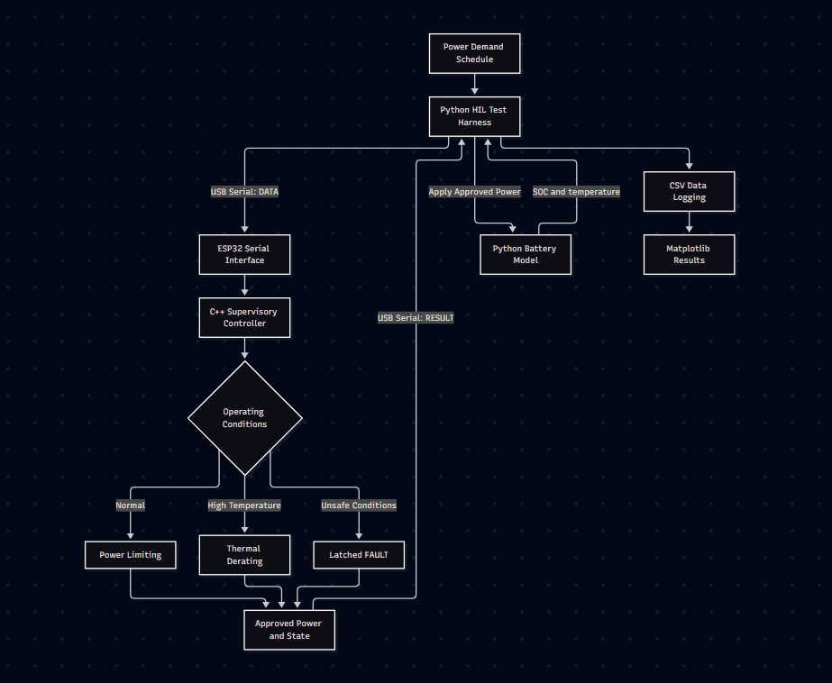
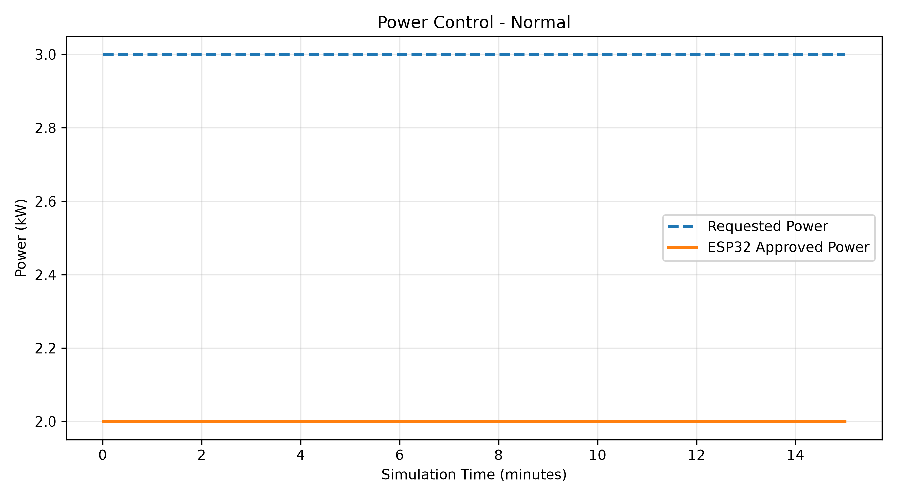
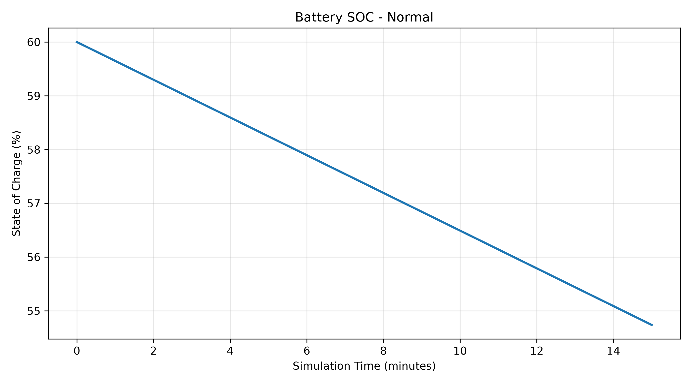
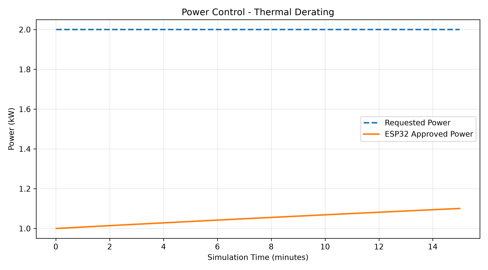
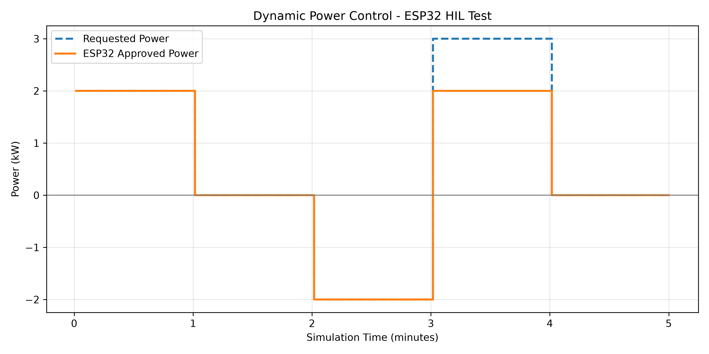
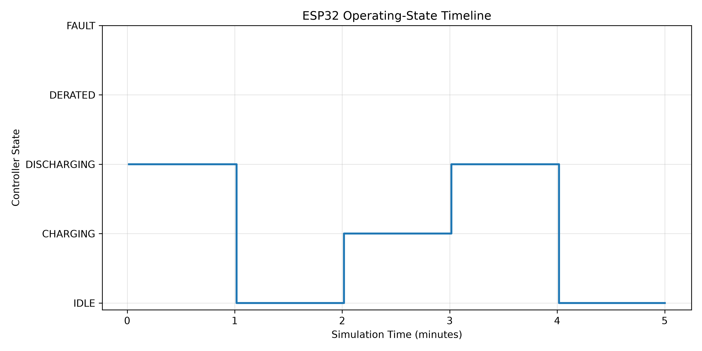
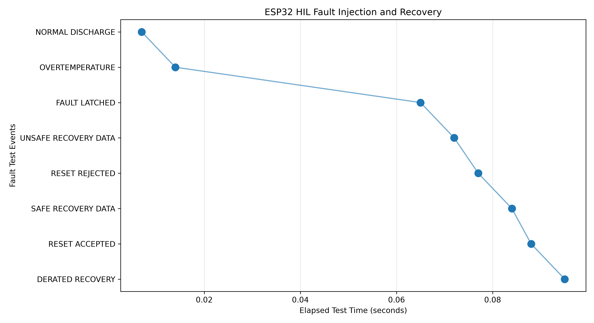

# ESP32-BESS-Controller

ESP32-based battery energy storage supervisory controller with Python simulation and hardware-in-the-loop testing.

# ESP32 Battery Energy Storage Supervisory Controller

**Python Battery Simulation | ESP32 C++ Firmware | Hardware-in-the-Loop Testing**

An embedded systems engineering project combining a simulated 10 kWh battery energy storage system with a physical ESP32 supervisory controller.

The battery is modelled in Python, while the ESP32 independently evaluates operating conditions, limits charging and discharging power, detects faults and manages recovery. Python communicates with the ESP32 over USB serial and performs automated hardware-in-the-loop (HIL) verification.

**The objective is to demonstrate embedded control, system integration, numerical modelling and engineering verification.**

## 1. System Overview



The system consists of three main components:

- **Python Battery Model:** Simulates state of charge, energy conversion efficiency, heat generation and cooling.
- **ESP32 Supervisory Controller:** Executes C++ control logic for power limiting, thermal derating, operating states and fault handling.
- **Python HIL Test Harness:** Sends simulated measurements, receives approved power commands, injects faults and records test results.

The ESP32 makes the control decisions. Python applies the approved power to the simulated battery and calculates its next state.

The complete architecture and serial protocol are documented in [System Architecture](docs/architecture.md).

## 2. Engineering Specifications

| Parameter                      | Value                   |
| ------------------------------ | ----------------------- |
| Battery capacity               | 10 kWh                  |
| Initial state of charge        | 60%                     |
| Operating SOC range            | 20-90%                  |
| Maximum charge/discharge power | ±2 kW                   |
| Charge/discharge efficiency    | 95%                     |
| Nominal simulation time step   | 1 second                |
| Thermal derating starts        | 40°C                    |
| Overtemperature shutdown       | 60°C                    |
| Fault reset temperature        | Below 55°C              |
| Communication watchdog         | 3 seconds               |
| Microcontroller                | ESP32 development board |
| Communication                  | USB serial, 115200 baud |

All battery characteristics are demonstration assumptions, not manufacturer specifications.

Positive power represents discharging; negative power represents charging.

## 3. Battery Modelling

The Python battery model uses energy conservation to calculate SOC.

During discharge:

\[
SOC*{new}=SOC*{old}-\frac{P\Delta t}{3600E\_{\max}\eta}\times100
\]

During charging:

\[
SOC*{new}=SOC*{old}-\frac{P\Delta t\eta}{3600E\_{\max}}\times100
\]

Power is expressed in kW, capacity in kWh and time in seconds. Charging power is negative.

A simplified lumped thermal model calculates battery temperature:

\[
C*{th}\frac{dT}{dt}=\dot Q*{gen}-UA(T-T\_{ambient})
\]

The model uses explicit Euler integration and assumes efficiency losses are converted into heat.

## 4. Supervisory Controller

The ESP32 implements five operating states:

| State       | Behaviour                             |
| ----------- | ------------------------------------- |
| IDLE        | No charging or discharging            |
| CHARGING    | Negative approved power               |
| DISCHARGING | Positive approved power               |
| DERATED     | Reduced power due to temperature      |
| FAULT       | Zero approved power and latched fault |

The controller enforces:

- Rated charging and discharging limits.
- SOC operating boundaries, including predicted boundary overshoot.
- Temperature-dependent power derating.
- Overtemperature shutdown.
- Invalid sensor measurement detection.
- Communication timeout detection.
- Latched faults and controlled reset.

The firmware is separated into serial communication and supervisory control modules.

## 5. Hardware-in-the-Loop Implementation

Python sends battery measurements and requested power to the physical ESP32.

Example request:

`DATA,60.0,25.0,3.0,1.0`

The ESP32 evaluates its operating limits and returns:

`RESULT,2.000000,DISCHARGING,NONE`

Python then applies the approved 2 kW to the battery simulation.

The simulation time step and real communication timing are separate. The communication watchdog uses real elapsed time on the ESP32.

## 6. Results

### Normal Operation

A 900-second HIL simulation demonstrated power limiting and battery energy integration.

- Requested discharge: 3 kW.
- ESP32 approved discharge: 2 kW.
- Initial SOC: 60%.
- Final SOC: 54.737%.
- Final simulated battery temperature: 26.52°C.





### Thermal Derating

A second HIL simulation started with an elevated simulated battery temperature of 50°C.

The ESP32 initially restricted discharge to 1 kW. As the simulated battery cooled to approximately 48.99°C, approved power increased to approximately 1.10 kW.



### Dynamic Power Control

A five-stage HIL scenario tested charging, discharging, idle operation and power limiting.





### Fault Injection and Recovery

Automated tests injected simulated overtemperature, invalid sensor values and communication faults.

The controller demonstrated fault latching, reset rejection and controlled recovery.



The graph records elapsed test time, not physical battery fault-detection latency.

## 7. Verification

| Verification activity               | Recorded result                          |
| ----------------------------------- | ---------------------------------------- |
| Python unit tests                   | 6 passed                                 |
| Python/ESP32 controller equivalence | 8 scenarios passed                       |
| ESP32 SOC boundary precision        | 6 scenarios passed                       |
| Rapid power changes                 | 100 requests passed                      |
| Communication watchdog              | Timeout detected at approximately 3.00 s |
| Overtemperature recovery            | Automated sequence passed                |
| Invalid sensor handling             | Fault latching verified                  |
| Malformed message testing           | Tested cases passed                      |

During development, a numerical precision error caused a small predicted SOC boundary overshoot. The implementation was corrected using a numerical guard band, then retested successfully.

The results and supporting CSV logs are available in the `results/` directory.

Detailed requirements and verification evidence are documented in [Requirements and Verification](docs/requirements.md).

## 8. Repository Structure

```text
battery_model/       Python battery and thermal model
controller/          Python reference controller
firmware/            ESP32 C++ firmware
tests/               Unit and hardware-in-the-loop tests
results/             CSV logs and engineering graphs
docs/                Architecture, requirements and evidence

simulate.py          Python-only simulation
hil_simulation.py     Initial closed-loop HIL test
hil_scenarios.py      Normal and thermal HIL scenarios
hil_dynamic.py        Dynamic operating-state scenario
hil_fault_logging.py  Automated fault-event recording
plot_results.py       Results visualisation
```

## 9. Running the Project

### Requirements

- Python 3
- ESP32 development board
- Arduino IDE with Espressif ESP32 board support
- USB cable
- Python libraries: `pyserial`, `pandas`, `matplotlib`

Install the Python dependencies:

```bash
python -m pip install pyserial pandas matplotlib
```

### ESP32 Firmware

1. Open `firmware/BESS_Controller/BESS_Controller.ino` in Arduino IDE.
2. Select the correct ESP32 board and serial port.
3. Upload the firmware.
4. Close Arduino Serial Monitor before executing Python HIL scripts.

The provided scripts use `COM5`. Change the port setting if your ESP32 uses another port.

### Python Simulation

```bash
python simulate.py
```

### HIL Simulation

```bash
python hil_simulation.py
```

### HIL Scenarios and Graphs

```bash
python hil_scenarios.py
python hil_dynamic.py
python hil_fault_logging.py
python plot_results.py
```

### Automated Testing

Run the Python-only unit tests:

```bash
python -m unittest tests.test_soc_boundaries tests.test_fault_handling -v
```

Hardware tests require a connected ESP32 running the matching firmware version. Run them individually with Arduino Serial Monitor closed.

For example:

```bash
python -m unittest tests.test_hil_controller -v
```

## 10. Engineering Limitations

This project is a supervisory control demonstration, not a physical battery management system.

- No physical battery pack, contactor or power converter is controlled.
- Battery electrical and thermal behaviour is simplified.
- The model has not been calibrated against experimental battery data.
- Sensor values are simulated and cannot establish independent physical safety.
- Fault handling and communication protection are software-based.
- HIL verification covers defined scenarios rather than all operating conditions.
- The implementation is not certified for safety-critical or industrial use.

## 11. Potential Improvements

- More detailed electrical and thermal battery models.
- Expanded serial communication fault testing.
- Independent firmware timing measurements.
- Configuration management between Python and ESP32.
- Automated test reporting and broader regression coverage.
- Integration with a representative low-voltage experimental system.

## Technologies

**Python, C++, ESP32, Arduino IDE, PySerial, Pandas, Matplotlib, Git and GitHub**

## Author

**Muhammed Farhan Ali**

MEng Mechanical Engineering - University of Leicester

[Engineering Portfolio](https://farhan10904.github.io/engineering-portfolio/) | [GitHub](https://github.com/farhan10904) | [LinkedIn](https://www.linkedin.com/in/farhan-ali-95047a245/)

## Acknowledgements

AI tools were used for planning, debugging assistance, code review, and documentation editing. final validation were performed and reviewed by the author.
