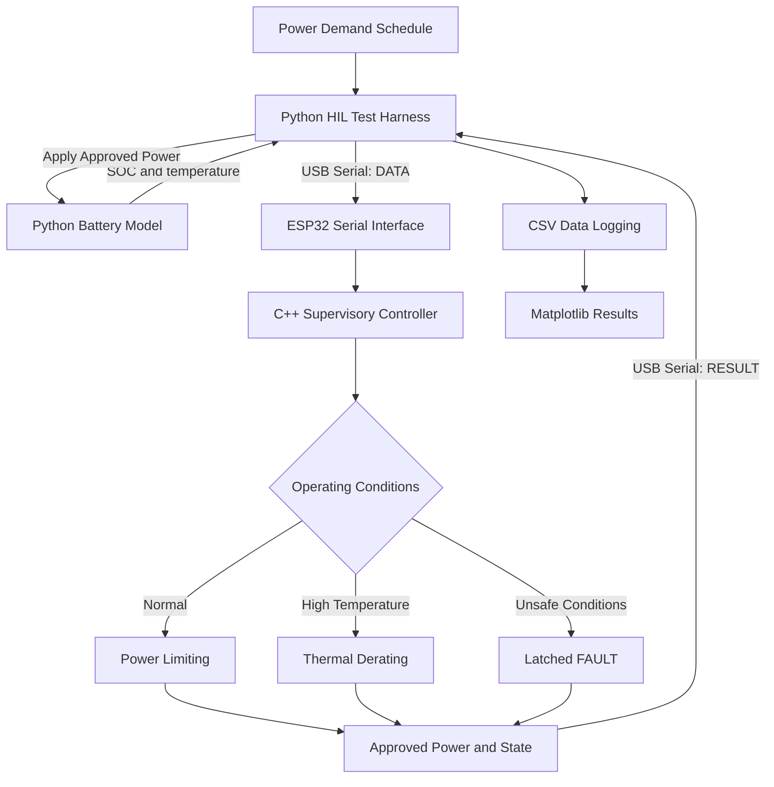

# System Architecture

## Overview

The project uses a physical ESP32 microcontroller to control
a simulated 10 kWh battery energy storage system.

Python simulates the battery, while the ESP32 independently
determines approved charging and discharging power.

## System Block Diagram

## Component Responsibilities

| Component              | Responsibility                                      |
| ---------------------- | --------------------------------------------------- |
| Battery model          | SOC, efficiency and thermal simulation              |
| HIL test harness       | Serial exchange, scenario execution and logging     |
| ESP32 serial interface | Message framing and input validation                |
| Supervisory controller | Power limiting, operating states and fault handling |
| Watchdog               | Communication timeout detection                     |
| Verification scripts   | Automated comparison and fault injection            |

## Communication Protocol

### Python to ESP32

`DATA,SOC,TEMPERATURE,POWER,DT`

Example:

`DATA,60.0,25.0,3.0,1.0`

### ESP32 to Python

`RESULT,APPROVED_POWER,STATE,FAULT`

Example:

`RESULT,2.000000,DISCHARGING,NONE`

### Fault Recovery

A valid zero-power DATA message must precede `RESET`.

The ESP32 evaluates the stored measurements before accepting
a fault reset.

## Safety and Scope

The ESP32 generates supervisory control decisions only.
It does not operate actual battery power electronics.

If the Python HIL simulation receives an invalid response
or encounters a communication failure, it stops advancing
the simulated battery rather than reusing a previous command.
